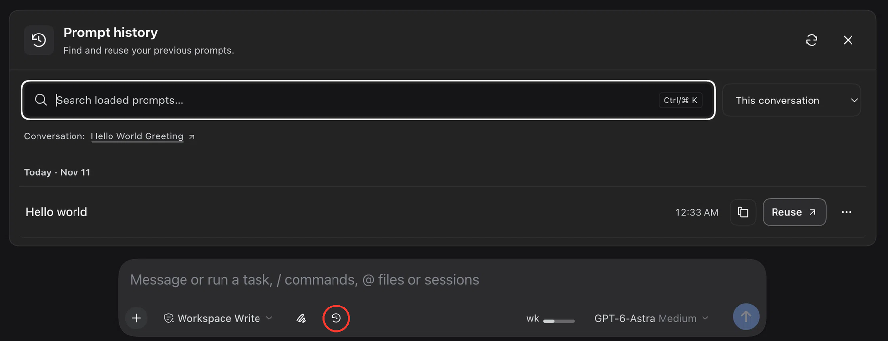

# Prompt history for DeepSeek Harness

Find and reuse previous prompts in the Harness composer without sending them automatically.

## Plugin submission

The sections below follow the [dsh-plugin.org submission template](https://dsh-plugin.org/submit). This is an independent plugin, not an official DeepSeek product.

### Repository

[EdgarSantiago/dsh-prompt-history](https://github.com/EdgarSantiago/dsh-prompt-history)

Public source repository maintained by [EdgarSantiago](https://github.com/EdgarSantiago). Package: `@local/dsh-prompt-history`, version `0.2.3`. The existing package and Slot identifiers are retained for compatibility with local installations. GitHub installation follows the published `main` branch.

### One-line value

Adds searchable human-prompt history to Harness so you can copy or reuse previous text in the composer without sending it automatically.

### Category

**Sessions & Messages**

### Install command

Requires **DeepSeek Harness `0.2.2-rc.1` or `0.2.2-rc.2`** and **Node.js 18+**. Choose the profile you use:

**Desktop**

```sh
dsh plugin --profile desktop add github:EdgarSantiago/dsh-prompt-history
```

**Web**

```sh
dsh plugin --profile web add github:EdgarSantiago/dsh-prompt-history
```

The repository includes the prebuilt Client. Follow the plugin manager's application/reload guidance; do not edit profile manifests manually.

This is a **GitHub-only source release**, not an npm release. The `private: true` flag prevents accidental npm publication; it does not prevent installation from GitHub. Existing local links remain valid. To replace a local installation with the GitHub source, remove the existing bundle through the plugin manager first.

### Compatibility

| Item | Declared compatibility |
| --- | --- |
| DeepSeek Harness | `0.2.2-rc.1` or `0.2.2-rc.2` |
| Profiles | Web and Desktop |
| Runtime | Node.js 18+ |
| Browser | Modern browser with Popover API support |
| Languages | English and Portuguese, following Harness |
| Verified platform | macOS; other platforms have not been visually certified |

The interface uses native Slots and Harness's React, without an iframe or a separate React installation. Other Harness versions are not declared compatible. The `0.2.2-rc.2` audit checked the shipped projection, composer, and Slot contracts; the custom menu explicitly excludes its visible box from macOS window dragging. Live visual interaction still needs confirmation after installation.

### License

[MIT](./LICENSE). The icon was originally drawn for this plugin.

### Screenshots / demo



*Actual plugin screenshot from 0.1.9, before panel keyboard navigation and quote/paste actions. The red outline marks the history launcher in the composer toolbar. The screenshot was cropped to highlight the panel and composer; the outline is an annotation only.*

### Notes

#### Usage

1. Click the **clock button outlined in red** in the screenshot, or focus the empty native composer and press **↑ once** or **↓ twice quickly (within 500 ms)**. The double-Down shortcut opens the panel with focus in its search field; the first Down press remains native, and holding the key does not count. **Ctrl+R** also opens the panel directly in reverse-search mode from an eligible plain-text composer, even when its draft is nonempty. Opening by keyboard selects the newest loaded prompt in **This conversation**, without inserting it.
2. Keep **This conversation**, or select **Recent conversations**.
3. Search the loaded text. Prompts are grouped by local day using **Today**, **Yesterday**, or a short date; each entry displays only its time.
4. Select **Reuse** to fill the composer, or the copy icon to copy the text.
5. Use **⋯** or right-click a history entry for **Copy**, **Quote in composer**, **Paste in composer**, expand/collapse, or the original conversation.
6. From the history search, **↓** enters the first result. Within the list, **↓** moves to the next visible row (older), and **↑** to the previous row (newer). At either end, selection and focus stay on that row; arrows never return focus to search. Use **Ctrl/⌘ K** or click the search field to return to it. Press **Ctrl+R inside the panel** to start reverse search; repeat it to select older matches. Changing the query selects its newest match.
7. **Enter** on the history search or a focused row pastes the selected text at the captured composer selection. Browsing/searching alone never edits the draft. Touch users can use **Older**, **Newer**, and **Reverse search** buttons instead.

**Paste** inserts at the native captured selection and revision, preserving surrounding draft content and existing attachments. **Quote** uses the native atomic quote action rather than simulating a quote with Markdown. Neither action sends a message. **Reuse** retains its separate confirmation before replacing an existing plain draft.

> **Keyboard scope:** the native-composer shortcuts only **open this panel**. They do not recall text directly into the composer. ↑/↓ remain native for every nonempty draft, so normal cursor movement is preserved. After opening, the panel owns its search and navigation keys; text is inserted only after an explicit **Paste**, **Quote**, **Reuse**, or panel **Enter** action. Right-click actions remain confined to history rows, not the native composer. No keybinding setup is required.

**DOM compatibility bridge:** automatic opening observes the exact card containing this plugin's clock, using Harness `0.2.2-rc.1` markers `[data-composer-card]`, `[data-composer-input]`, and `[data-trigger-menu]`. This is a version-dependent DOM integration, not a stable public composer-keyboard API. It reads focus/selection and UI markers but never writes the native editor's DOM or selection. Unknown markup fails closed; the clock remains available. The bridge declines IME/composition, selected text, active menus/modals, busy/claimed input, bang/slash/reference prefixes, attachments, reference/command/quote chips, and ambiguous duplicate composer surfaces for the same Session. The double-Down sequence resets after another key, a click, focus loss, IME, a draft revision change, editor replacement, or a newly blocked input; it never carries across Session/component lifetimes. Other fields and Command+R stay native; Ctrl+R suppresses browser refresh only when an eligible composer accepts the opening action. Use only one composer-history keyboard interceptor at a time.

The DOM approach was checked against the [reference terminal-history plugin](https://github.com/Xiaofei-fei/dsh-prompt-history). This implementation keeps its own projection-backed history and opens a non-destructive panel instead of replacing the draft while browsing.

History opens above the composer and closes when you click or tap outside the panel and clock button. The outside interaction keeps its action and focus without changing the draft. In the current-conversation filter, the conversation appears once above the list; in recent-conversation results, each entry identifies its source. **Refresh** reloads history, and **Load more conversations** extends the loaded set.

#### Permissions and privacy

- **Read access:** only committed human messages and conversation projections permitted by native Harness endpoints. Drafts, model responses, tool results, injections, and automated tasks are excluded.
- **Write access:** fills only the local draft after an explicit action; does not modify sent messages. Replacing an existing draft requires confirmation, and concurrent draft revisions are preserved.
- **Clipboard:** writes text only when you click the copy icon or choose **Copy** in a row's menu. It never reads the system clipboard.
- **Storage:** uses the Harness log and projection cache, without a separate prompt database or history stored in localStorage.
- **External services:** adds no external integrations or AI calls. Opening, searching, and reusing history do not call a model; sending a message afterward remains a normal Harness action.
- **Inactive sessions:** reading history does not start an Agent or silently migrate conversations. Read failures appear as warnings, never as a successful empty history.

> **Reuse does not send messages, execute commands, or restore attachments or references.** Sensitive information remains part of a saved prompt: review it before copying, sending, or including it in a screenshot.

#### Known limits

- Up to **60 prompts** and **262,144 characters** per conversation.
- Recent-conversation browsing initially reads up to **10 conversations**, with a maximum of **50 accessible conversations**, prioritizing the current one and then recent activity. The current-conversation filter does not read other conversations.
- Search is local, literal, and case/accent insensitive, covering **only loaded text**, not the entire archive.
- Prompts exceeding **32,768 characters** are incomplete previews: copy, quote, paste, and reuse are disabled; open the original conversation for the full text.
- **Reuse** does not replace drafts containing attachments or references. Whole-draft replacement can also be refused for atomic quote content; use additive **Paste**/**Quote** or clear the draft yourself. No destructive fallback is attempted.
- **Paste** rejects bang-prefixed text/current terminal drafts and private editor reference markers. Native **Quote** can safely quote a bang-prefixed prompt without executing it; private reference-marker text and incomplete previews remain blocked.
- The history-row paste action pastes that prompt's text. It does not read the system clipboard or replace the browser's native paste menu.
- Subagents are excluded. Ordinary forks are included without repeating their inherited prefix.

#### Keyboard and accessibility

| Action | Shortcut/behavior |
| --- | --- |
| Open history and focus search from the native composer | `↑` once or `↓` twice within 500 ms, with an empty, unstructured draft and a collapsed caret |
| Open reverse search from the native composer | `Ctrl+R` in an eligible plain-text composer |
| Focus search | `Ctrl/⌘ K`, while focus is inside the panel |
| Enter results from search | `↓` focuses the first result |
| Next/previous visible history row | `↓` / `↑`; focus stays in the list at both boundaries |
| Reverse search / older match | `Ctrl+R` inside the history panel |
| Paste selected prompt | `Enter` in history search or on a focused history row |
| Open a history row's actions | Right-click, ContextMenu key, or `Shift+F10` on the row |
| Exit reverse search | `Escape`; this leaves the history panel open |
| Close the panel or cancel confirmation | `Escape` outside reverse-search mode |
| Navigate the **⋯** menu | Arrow keys, `Home`, and `End` |
| Close the menu | `Escape`, returning focus to its button |

Icon buttons have accessible names, focus is visible, actions reflow in narrow panels, and animations respect `prefers-reduced-motion`.

#### Development

```sh
pnpm install --frozen-lockfile --ignore-scripts
pnpm run build
pnpm run check
pnpm test
```

For a local development installation, run `dsh plugin --profile desktop add "$(pwd)"` from the project root after building (or use `--profile web`). Manage updates through the Harness plugin manager.

The Client is bundled with esbuild; there is no install script. Tests use Node's built-in runner, synthetic data, real Date/Intl, and real Cordis Context/Service instances. They cover human sources, bounds, ACLs, cancellation, draft confirmation, local dates, year boundaries, daylight-saving transitions, outside-pointer dismissal, stable-key history navigation, captured insertion spans, native quote/paste refusal, panel keyboard integration contracts, and composer-opening policy/listener lifecycle using real Node EventTarget/Event instances. DOM markers were checked against installed Harness source; the browser DOM probe and visual keyboard interactions still require a manual check in the running app. Contract tests do not replace interaction checks in Harness.

### Pre-submission checklist

- [x] Repository is public.
- [x] GitHub topic `dsh-plugin` added.
- [x] README includes the install command.
- [x] Plugin exports an `apply(ctx)` module.
- [x] Repository root includes a `package.json`.

**Website vs. Plugin Hub:** according to the [listing requirements](https://dsh-plugin.org/submit), a public repository with the `dsh-plugin` topic can be indexed on the website without npm. The **Plugin Hub inside DSH** additionally requires an installable npm package. Source publication does not imply catalog listing or completed community verification; neither is claimed here.
